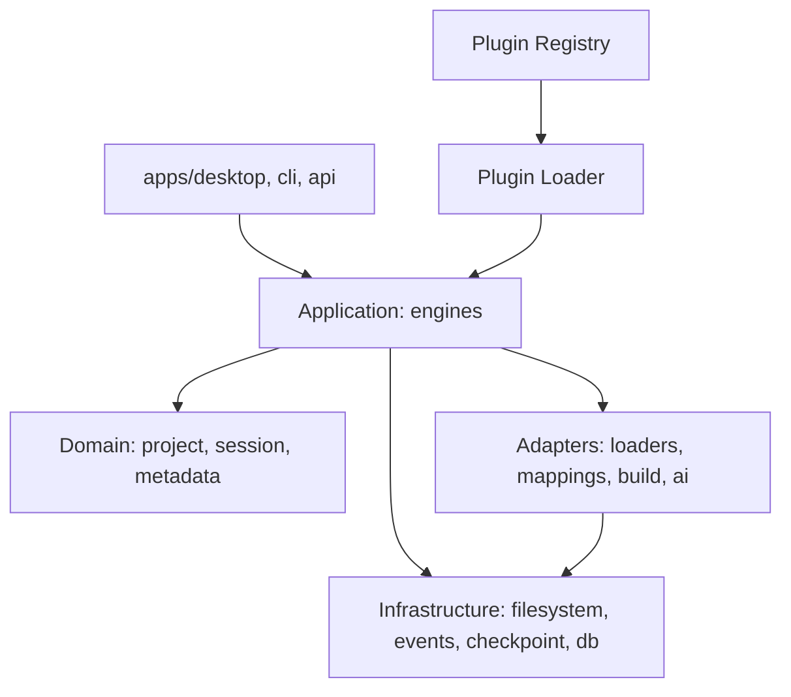

# DEPENDENCY_GRAPH — Module Dependencies

Direction rule: Presentation → Application → Domain; Infrastructure → Application/Domain abstractions. Domain never depends on GUI, DB, AI provider, or loader implementation.

## Layer order (build order)
1. **Domain** (CORE-03 Project Metadata) — no deps.
2. **Infrastructure base** (CORE-02 FileSystem, CORE-05 Event Bus, CORE-06 Checkpoint, CORE-07 Job Persistence via DB).
3. **Application core** (CORE-01 Project Manager, CORE-04 Migration Session).
4. **Engines** (ENG-01 Analyzer → ENG-02 Compatibility → ENG-03 Migration → ENG-04 Build → ENG-05 Testing).
5. **AI** (AI-01 Provider abstraction → AI-02 Orchestrator).
6. **Plugins** (PLG-01 Registry → PLG-02 Loader).
7. **Presentation** (apps/desktop, apps/cli, apps/api).

## Parallel work
- Domain + Infrastructure base can run in parallel.
- Analyzer and Compatibility engines can start in parallel; Migration depends on both.
- AI-01 and Plugin Registry are independent; both feed AI-02/PLG-02.
- Build engine and Testing engine share the toolchain/sandbox interface; can be built in parallel after the interface is frozen.

## No cycles
All arrows point down-layer. Adapters depend on interfaces, never on each other.

## Diagram
